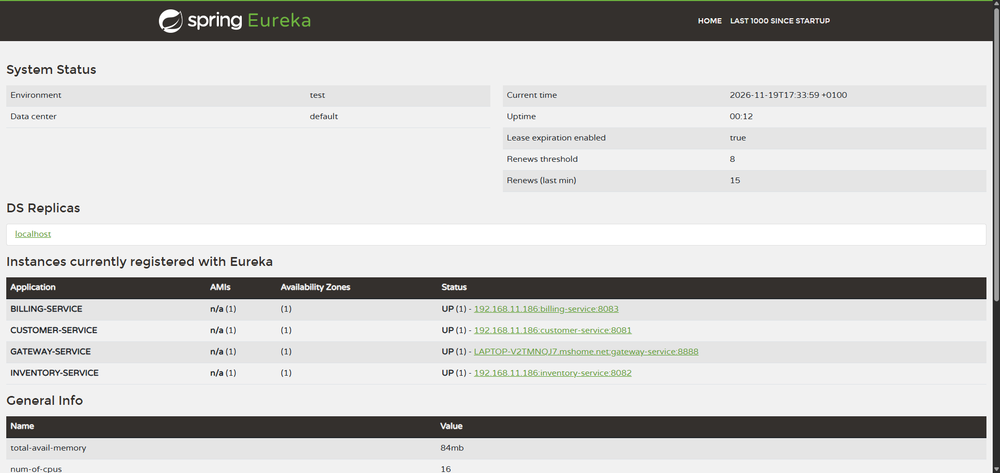
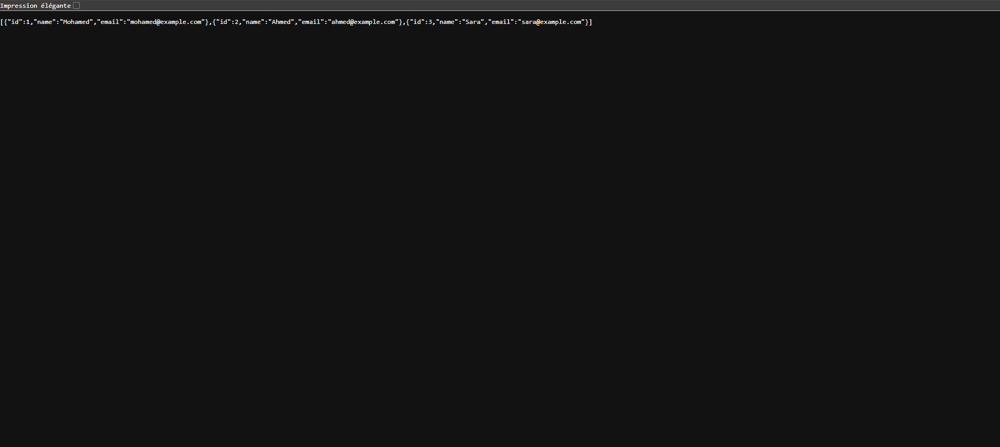
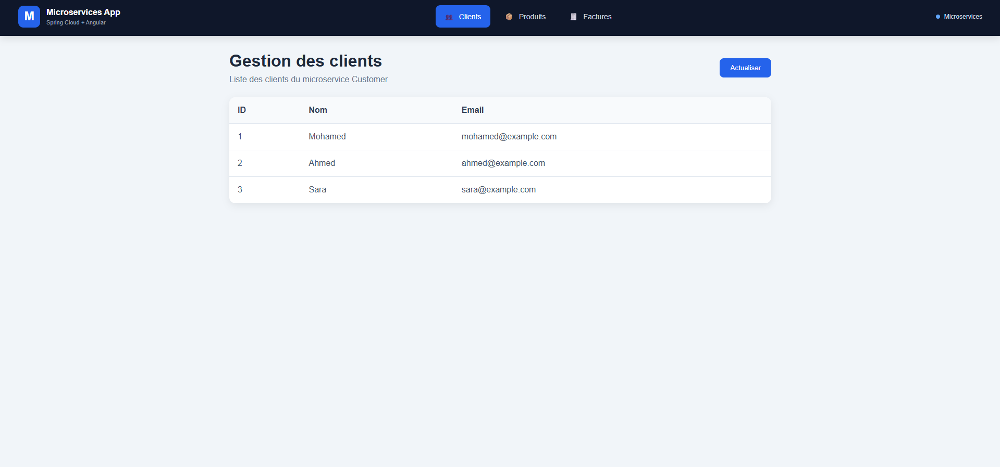
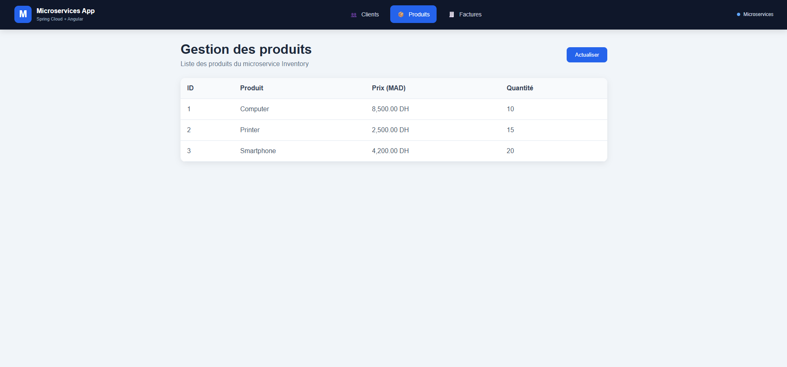
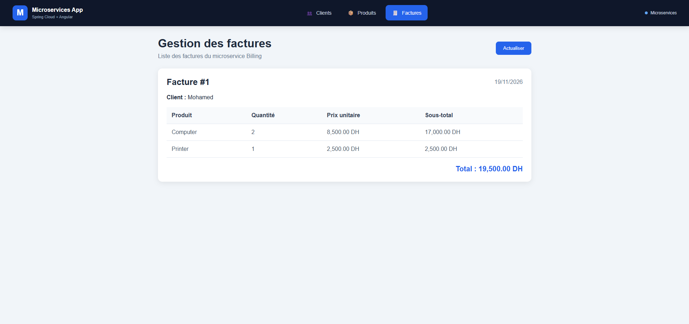

# TP2 — Architecture Microservices avec Spring Boot et Spring Cloud

## Présentation

Ce projet a été réalisé dans le cadre du TP2 Spring Boot et Spring Cloud.

L'objectif est de développer une application de gestion des clients, des produits et des factures en utilisant une architecture microservices.

L'application comprend plusieurs services backend développés avec Spring Boot et une interface frontend développée avec Angular.

## Technologies utilisées

- Java 17
- Spring Boot 3.3.5
- Spring Cloud
- Spring Cloud Gateway
- Netflix Eureka Discovery Server
- Spring Cloud Config Server
- Spring Data JPA
- H2 Database
- Angular
- TypeScript
- Maven
- Git et GitHub

## Architecture du projet

```text
                Angular Frontend
                 localhost:4200
                       |
                       v
              Spring Cloud Gateway
                 localhost:8888
                       |
          +------------+------------+
          |            |            |
          v            v            v
    Customer       Inventory      Billing
    Service        Service        Service
    :8081          :8082          :8083

              Eureka Discovery
                localhost:8761

             Spring Config Server
                localhost:9999
```

## Microservices

| Service | Port | Description |
|---------|------|-------------|
| Config Service | 9999 | Gestion centralisée de la configuration |
| Discovery Service | 8761 | Enregistrement et découverte des services |
| Gateway Service | 8888 | Point d'entrée des API |
| Customer Service | 8081 | Gestion des clients |
| Inventory Service | 8082 | Gestion des produits |
| Billing Service | 8083 | Gestion des factures |
| Angular Frontend | 4200 | Interface utilisateur |

## Fonctionnalités

### Gestion des clients
- Consultation de la liste des clients
- Communication avec Customer Service
- Affichage des clients dans Angular

### Gestion des produits
- Consultation des produits
- Communication avec Inventory Service
- Affichage des produits dans Angular

### Gestion des factures
- Consultation des factures
- Communication avec Billing Service
- Affichage des factures dans Angular

### Architecture Spring Cloud
- Découverte des microservices avec Eureka
- Routage des requêtes via Spring Cloud Gateway
- Configuration centralisée avec Spring Cloud Config

## Captures d'écran

### 1. Eureka Discovery Server

Tableau de bord Eureka permettant de visualiser les microservices enregistrés.



### 2. Customer Service — API REST

Test de récupération des clients via Spring Cloud Gateway.

Endpoint testé :

`GET http://localhost:8888/customer-service/customers`



### 3. Interface Angular — Gestion des clients

Affichage des clients dans l'application Angular.



### 4. Interface Angular — Gestion des produits

Affichage des produits dans l'application Angular.



### 5. Interface Angular — Gestion des factures

Affichage des factures dans l'application Angular.



## Installation et exécution

### Prérequis

- JDK 17
- Maven ou Maven Wrapper
- Node.js et npm
- Git

### 1. Cloner le dépôt

```bash
git clone https://github.com/mohamed-yawina/tp2-microservices-spring-cloud.git
cd tp2-microservices-spring-cloud
```

### 2. Démarrer les microservices

Démarrer chaque service dans un terminal séparé, en respectant l'ordre suivant :

1. Config Service
2. Discovery Service
3. Customer Service
4. Inventory Service
5. Billing Service
6. Gateway Service

Exemple pour Customer Service :

```powershell
cd customer-service
.\mvnw.cmd spring-boot:run
```

Répéter cette opération dans le dossier de chaque service.

### 3. Démarrer Angular

```powershell
cd angular-frontend
npm install
npm start -- --proxy-config proxy.conf.json
```

L'application est accessible à l'adresse :

http://localhost:4200

## Vérification

### Eureka Dashboard

http://localhost:8761

### Customer Service via Gateway

http://localhost:8888/customer-service/customers

### Interface Angular

http://localhost:4200

## Structure du projet

```text
tp2-microservices-spring-cloud/
|
|-- config-service/
|-- discovery-service/
|-- customer-service/
|-- inventory-service/
|-- billing-service/
|-- gateway-service/
|-- angular-frontend/
|-- docs/
|   `-- screenshots/
|       |-- 01-eureka.png
|       |-- 02-customer-service.png
|       |-- 03-Gestion_Clients.png
|       |-- 04-Gestion_Produits.png
|       `-- 05-Gestion_Factures.png
|
`-- README.md
```

## Auteur

**Mohamed Yawina**

Étudiant en dernière année du cycle d'ingénieur en informatique à l'EMSI.

Projet académique — Spring Boot & Spring Cloud.
